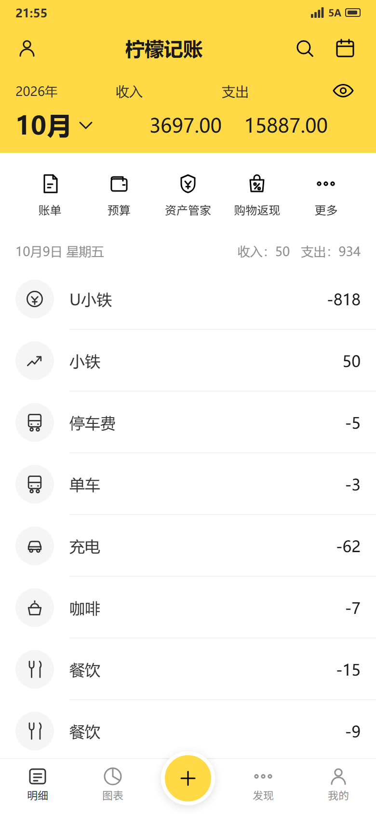
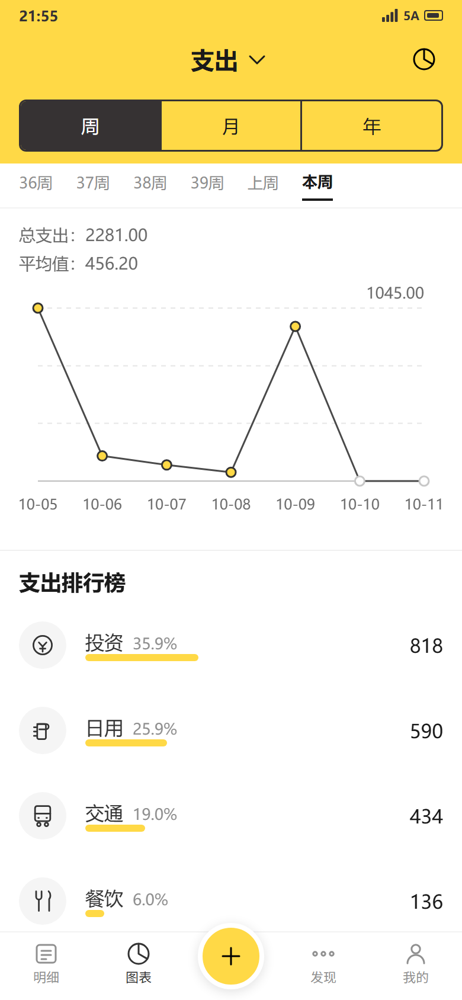
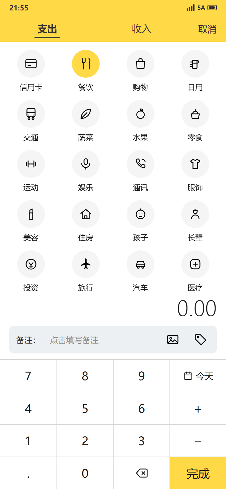

# 02 · 概要设计与 UI 规范

| 项目 | 内容 |
|---|---|
| 产品名称 | 小猪记账 / LemonLedger (v1.0 柠檬记账, v1.6.4 改名) |
| 文档版本 | v1.0-draft1 → v1.9.0 |
| 编制日期 | 2026-10-09 |
| 最近更新 | 2026-10-31 (v1.9.0) |
| 编制角色 | 架构师 / 技术负责人、UI/UX 设计师 |
| 评审角色 | PM / 测试负责人 |
| 状态 | ✅ 已交付 (v1.9.0 release, 含 标签统计 + 日期选择器 + 记一笔重设计规范) |
| 基线依赖 | [`docs/00-基线与术语.md`](00-基线与术语.md) |

## 修订记录

| 版本 | 日期 | 修订人 | 修订说明 |
|---|---|---|---|
| v1.0-draft1 | 2026-10-09 | 架构师 / UI | 首版：选型对比、分层架构、数据模型、算法、UI 规范 |

---

## 1. 设计目标与约束

| 编号 | 目标/约束 | 说明 |
|---|---|---|
| G-1 | 记账路径最短 | 从明细页到保存完成 ≤ 4 次点击；记账页禁止任何弹窗打断 |
| G-2 | 统计与展示完全同源 | 明细合计、日小计、图表走势、排行榜共用同一套金额聚合函数，杜绝口径漂移 |
| G-3 | 纯本地且可离线 | 无网络请求；数据在应用私有目录；备份/导出为唯一数据出口 |
| G-4 | 视觉零学习成本 | 严格复刻参考图的信息层级与配色，主体色 `#FFD946`，无渐变无投影 |
| G-5 | 可测试 | 金额、日期、统计、备份序列化四类逻辑必须与 UI 解耦，可独立单元测试 |
| G-6 | 数据规模可扩展 | 10 万条流水下统计查询仍 < 300ms |

---

## 2. 技术选型

### 2.1 候选方案对比

| 维度 | 方案 A：Kotlin + Jetpack Compose（原生） | 方案 B：Flutter | 方案 C：React Native / uni-app |
|---|---|---|---|
| UI 还原度（对照参考图） | ★★★★★ 原生 Canvas 与 Material3，像素级可控 | ★★★★★ 自绘引擎，跨端一致性强 | ★★★☆☆ 需桥接，细节动画略弱 |
| 列表性能（1 万条） | ★★★★★ LazyColumn + Paging 原生最优 | ★★★★☆ ListView.builder 优秀 | ★★★☆☆ 大列表需虚拟化调优 |
| 自定义图表（折线/进度条） | ★★★★☆ 需自绘或用轻量库 | ★★★★★ 自绘极为方便 | ★★★☆☆ 依赖第三方库 |
| 本地数据库 | Room（成熟，编译期校验 SQL） | sqflite / Drift（成熟） | SQLite / WatermelonDB |
| 包体积基线 | **约 8–12MB**（最优） | 约 20–25MB | 约 25–35MB |
| Android 冷启动 | **最快** | 中等（引擎初始化） | 较慢（JS 桥） |
| 开发效率 | ★★★☆☆ 需 Android 专业知识 | ★★★★★ 热重载，迭代最快 | ★★★★☆ 前端技能可复用 |
| 未来支持 iOS | 需重写 | **一套代码直接支持** | 一套代码支持，但体验折扣 |
| 生态与长期维护 | 官方主推，最稳 | 社区活跃，版本迭代快 | 依赖第三方库维护状况 |
| 人力可得性 | 需 Android 工程师 | 需 Flutter 工程师 | 前端工程师即可上手 |
| 本机环境就绪度 | 需装 JDK 17 + Android SDK | 需装 JDK + Flutter SDK + Android SDK | 需装 Node + Android SDK |
| 与参考图信息密度匹配度 | ★★★★★ | ★★★★★ | ★★★★☆ |

### 2.2 评估结论（供决策参考，非最终决定）

- **若以「还原度高 + 包体积小 + 纯本地 + 长期稳定」为第一目标** → 推荐 **方案 A（Kotlin + Jetpack Compose）**。本产品无跨端诉求、无服务端，原生方案的包体积、冷启动与列表性能优势直接命中 NFR-1 与 NFR-7。
- **若未来明确要做 iOS** → 推荐 **方案 B（Flutter）**。UI 还原度几乎无损，代价是包体积增加约 10MB。
- **方案 C** 仅在团队已有成熟前端且明确要覆盖小程序/H5 时考虑。

> 该结论为**建议**，最终选型由用户在 ADR-02 中勾选确认（TBD-02）。

### 2.3 三方案共同的能力下限（无论选哪个都必须满足）
1. 本地关系型数据库（Room / Drift / SQLite）。
2. 自绘或可控的折线图、进度条。
3. 文件读写与系统分享（备份/导出）。
4. 生物识别与密码锁（Keystore / 平台安全存储）。
5. 金额与统计逻辑可脱离 UI 单元测试。

---

## 3. 系统架构

### 3.1 分层结构（以方案 A 表述，方案 B/C 结构同构）

```text
┌─────────────────────────────────────────────────────────┐
│  UI 层（Compose Screen + Component）                     │
│  ListScreen / ChartScreen / EntryScreen / MineScreen     │
│  只负责渲染与事件转发，不含任何计算逻辑                    │
└────────────────────────┬────────────────────────────────┘
                         │ StateFlow<UiState>
┌────────────────────────┴────────────────────────────────┐
│  表现层（ViewModel）                                      │
│  ListViewModel / ChartViewModel / EntryViewModel         │
│  组合用例、持有 UI 状态、处理防抖与一次性事件              │
└────────────────────────┬────────────────────────────────┘
                         │ suspend 调用
┌────────────────────────┴────────────────────────────────┐
│  领域层（UseCase + 纯函数）                               │
│  AmountFormatter / DateRange / StatisticsCalculator      │
│  BackupCodec   ← 无 Android 依赖，可 JVM 单元测试         │
└────────────────────────┬────────────────────────────────┘
                         │
┌────────────────────────┴────────────────────────────────┐
│  数据层（Repository + DAO）                               │
│  TransactionRepository / CategoryRepository              │
│  SettingsRepository / BackupService                      │
└────────────────────────┬────────────────────────────────┘
                         │
┌────────────────────────┴────────────────────────────────┐
│  存储层  Room(SQLite) + 应用私有目录文件                   │
└─────────────────────────────────────────────────────────┘
```

### 3.2 模块划分

| 模块 | 职责 | 对应 FR | 可独立测试 |
|---|---|---|---|
| `core:money` | 金额分转字符串、格式化、解析 | FR-1.3, BR-1.1 | 是（纯函数） |
| `core:date` | 周期区间计算、周序号、epochDay 转换 | FR-3.3, FR-6.1 | 是（纯函数） |
| `core:stats` | 合计、平均值、占比、排行榜、折线序列 | FR-2.2, FR-3.4~3.6 | 是（纯函数） |
| `data:db` | Room 实体、DAO、迁移 | 全部 | 是（仪器测试） |
| `data:backup` | 备份序列化、校验、恢复、CSV/XLSX | FR-4.* | 是（纯函数 + 文件） |
| `feature:entry` | 记账页 | FR-1.* | UI 测试 |
| `feature:list` | 明细页 | FR-2.* | UI 测试 |
| `feature:chart` | 图表页 | FR-3.* | UI 测试 |
| `feature:mine` | 我的/设置/分类/标签 | FR-5.*, FR-6.* | UI 测试 |

### 3.3 数据流（记账一次的全过程）

```text
用户点「完成」
  → EntryViewModel.submit()（300ms 防抖）
  → 校验 amountCents > 0（否则发出一次性提示事件）
  → TransactionRepository.insert(Transaction)
  → Room 写入，Flow 自动发出新数据
  → ListViewModel 的 monthTransactions Flow 触发
  → StatisticsCalculator 重算月度合计与分组
  → ListScreen 重组并高亮新条目
  → EntryViewModel 发出 CloseEntry 事件 → 返回明细页
```
**关键点**：明细、日小计、图表共用 `StatisticsCalculator`，因此编辑或删除后无需"各页刷新"，Room 的 Flow 会带动全部下游重算（G-2）。

---

## 4. 数据模型

### 4.1 ER 关系

```text
Category ──1:N──> Transaction ──N:M──> Tag
   │                    │
   └── self-ref parentId ┘（一级/二级分类）
AppSetting（键值单例）
```

### 4.2 表结构（DDL 草案，SQLite）

```sql
CREATE TABLE category (
  id           INTEGER PRIMARY KEY AUTOINCREMENT,
  name         TEXT    NOT NULL,
  type         TEXT    NOT NULL CHECK(type IN ('EXPENSE','INCOME')),
  icon_key     TEXT    NOT NULL,
  parent_id    INTEGER REFERENCES category(id),
  sort_order   INTEGER NOT NULL DEFAULT 0,
  is_builtin   INTEGER NOT NULL DEFAULT 0,
  is_active    INTEGER NOT NULL DEFAULT 1,
  created_at   INTEGER NOT NULL,
  updated_at   INTEGER NOT NULL,
  UNIQUE(parent_id, name, is_active)
);
CREATE INDEX idx_category_type_active ON category(type, is_active, sort_order);

CREATE TABLE transaction (
  id                   INTEGER PRIMARY KEY AUTOINCREMENT,
  ledger_id            INTEGER NOT NULL DEFAULT 1,
  type                 TEXT    NOT NULL CHECK(type IN ('EXPENSE','INCOME')),
  amount_cents         INTEGER NOT NULL CHECK(amount_cents > 0),
  category_id          INTEGER NOT NULL REFERENCES category(id),
  tag_ids              TEXT,                       -- 逗号分隔，v1.0 不做关联表
  trade_date_epoch_day INTEGER NOT NULL,
  note                 TEXT,
  photo_uris           TEXT,
  created_at           INTEGER NOT NULL,
  updated_at           INTEGER NOT NULL,
  deleted_at           INTEGER
);
CREATE INDEX idx_tx_date    ON transaction(ledger_id, trade_date_epoch_day DESC, created_at DESC) WHERE deleted_at IS NULL;
CREATE INDEX idx_tx_month   ON transaction(ledger_id, type, trade_date_epoch_day) WHERE deleted_at IS NULL;
CREATE INDEX idx_tx_cat     ON transaction(category_id);

CREATE TABLE tag (
  id         INTEGER PRIMARY KEY AUTOINCREMENT,
  name       TEXT NOT NULL UNIQUE,
  sort_order INTEGER NOT NULL DEFAULT 0,
  created_at INTEGER NOT NULL
);

CREATE TABLE app_setting (
  key   TEXT PRIMARY KEY,
  value TEXT NOT NULL
);
```

**设计说明**
- `tag_ids` 用逗号分隔而非关联表：标签数量 ≤5、无按标签聚合的强需求，避免一次 join；如 v1.1 需要标签统计，再做迁移（ADR-04）。
- `idx_tx_date` 为部分索引（`WHERE deleted_at IS NULL`），贴合"默认只查未删除"的访问模式。
- 月度合计查询按 `type + 日期区间` 走 `idx_tx_month` 覆盖，避免全表扫描（G-6）。

### 4.3 实体字段定义

以基线 §6 为准。补充注释：

| 字段 | 类型 | 约束与说明 |
|---|---|---|
| `amount_cents` | Long | > 0；上限 99,999,999,999 分（≈10 亿） |
| `trade_date_epoch_day` | Int | 本地日历日；`LocalDate.ofEpochDay` 转换 |
| `note` | String? | ≤ 50 字符；为空时列表回退显示分类名（A-4） |
| `photo_uris` | String? | 应用私有目录相对路径，v1.0 最多 1 个 |
| `created_at` / `updated_at` | Long | epoch milliseconds |

### 4.4 数据库版本与迁移策略
- 初始 `version = 1`。
- 后续版本一律提供显式 `Migration`，禁止 `fallbackToDestructiveMigration`（用户数据不可丢）。
- 每次迁移必须配套一个"迁移前后数据一致性"测试用例（`04` TC-B 域）。

---

## 5. 核心算法设计

### 5.1 周期区间与周序号（`core:date`）

```text
输入：维度（WEEK/MONTH/YEAR）、锚点日期 anchor、每周起始日 weekStart
输出：Period(startEpochDay, endEpochDay, label, elapsedDays, isCurrent)

WEEK : start = anchor 回退到本周起始日；end = start + 6
       周序号 = ISO8601 周序号（周起始日为周一时与 ISO 一致；为周日时按周日起算重新编号）
       当周离今天 ≤1 个周期时，label 用「上周」/「本周」，否则用「NN周」
MONTH: start = 当月 1 日；end = 当月最后一天；label = 「M月」
YEAR : start = 当年 1 月 1 日；end = 12 月 31 日；label = 「YYYY」

elapsedDays = if (end < today) (end - start + 1)      // 完整周期
              else if (start > today) 0               // 未来周期
              else (today - start + 1)                // 进行中
```
**边界**：`elapsedDays = 0` 时平均值按 `0.00` 处理，不产生除零。

### 5.2 统计聚合（`core:stats`，纯函数）

```text
aggregate(transactions, period, type) -> PeriodStat {
  totalCents   = Σ amount_cents where type 匹配且未删除且落在 period 内
  avgCents     = if (elapsedDays > 0) round(totalCents / elapsedDays) else 0
  dailySeries  = 按日分桶的金额数组（长度 = 周期天数，未来日期填 0）
  yAxisMaxCents= max(dailySeries)，若为 0 则 1 分
  ranking      = 按分类聚合 → 按金额降序、同额按 sort_order 升序 → 过滤 0 元项
  ranking[i].percent = round(amount*1000 / total) / 10   // 保留 1 位小数百分比
  ranking[i].barRatio = amount / total                   // 进度条长度比例（用原始比值，不用四舍五入后的百分比）
}
```
**关键决策**：进度条长度用**未取整的原始比值**，而百分比文字用四舍五入值。这样 `35.9%` 的条长精确等于 `818/2281`，避免参考图中"文字与条长对不上"的观感问题（ADR-03）。

### 5.3 金额格式化（`core:money`）

```text
format(cents: Long, hide: Boolean) -> String
  hide == true  → "****"
  否则          → 千分位整数 + "." + 两位小数，例：228100 → "2,281.00"
列表行金额    → 支出前缀 "-"，收入无前缀（与参考图一致，见 FR-2.4）
合计/统计金额  → 无前缀，直接显示正数
```
全流程**不出现浮点数**：分转字符串用整数除余运算实现。

### 5.4 防抖与并发
- 「完成」键 300ms 内重复点击只触发一次提交（`BR-1.6.4`）。
- 数据库写入使用单线程调度器，避免并发写导致的自增主键乱序。

---

## 6. UI 规范

> 色值、字号、间距以基线 §5 为唯一依据；本节给出**组件级规格与页面结构**。

### 6.1 组件规格

#### C-01 顶栏 Header
| 属性 | 值 |
|---|---|
| 高度 | 状态栏 + 48dp |
| 背景 | `#FFD946` |
| 标题 | 20sp Bold `#1A1A1A`，居中 |
| 左右图标 | 24dp 线性图标，`#1A1A1A`，热区 48dp |
| 分割 | 无阴影、无下边框 |

#### C-02 分段控件 SegmentControl
| 属性 | 值 |
|---|---|
| 外框 | 1.5dp `#363233` 描边，圆角 6dp，高度 44dp |
| 选中段 | 底色 `#363233`，文字白色 15sp |
| 未选中段 | 底色 `#FFD946`，文字 `#1A1A1A` 15sp |
| 段间 | 1.5dp 竖线分隔 |

#### C-03 分类项 CategoryItem
| 属性 | 值 |
|---|---|
| 列数 | 4（等宽），行高 88dp |
| 图标圆 | 48dp，未选中底 `#F5F5F5`，选中底 `#FFD946` |
| 图标 | 24dp 线性，描边 1.5dp，`#333333` |
| 文字 | 13sp `#1A1A1A`，距圆底 8dp，单行省略 |

#### C-04 数字键盘 Keypad
| 属性 | 值 |
|---|---|
| 布局 | 4 列等宽 × 4 行等高（每行 56dp），1px `#D7D7D7` 格线 |
| 普通键 | 白底，文字 20sp `#1A1A1A` |
| `+` / `−` | 同普通键，符号略大 22sp |
| `今天` | 图标 18dp + 文字 15sp 横排 |
| `完成` | **第 4 行第 4 列**，与其余键等高（56dp），底 `#FFD946`，文字 20sp `#1A1A1A` |
| 按压反馈 | 底色变 `#F5F5F5`，无缩放动画 |

#### C-05 备注行 NoteRow
| 属性 | 值 |
|---|---|
| 高 | 48dp，圆角 8dp，底 `#ECF0F3` |
| 左文案 | 「备注：」14sp `#333333` |
| 占位 | 「点击填写备注」14sp `#8F8F8F` |
| 右图标 | 图片、标签各 20dp，间距 16dp |

#### C-06 流水行 TransactionRow
| 属性 | 值 |
|---|---|
| 高 | 64dp |
| 图标圆 | 40dp 底 `#F5F5F5`，图标 22dp 描边 `#333333` |
| 主标题 | 16sp `#333333`，距图标 16dp |
| 金额 | 16sp Medium `#1A1A1A`，右对齐距边 16dp |
| 分割线 | 高 1px `#F0F0F0`，**左端缩进 72dp** |

#### C-07 日分组头 DayHeader
| 属性 | 值 |
|---|---|
| 高 | 36dp |
| 左 | `MM月DD日 星期X` 13sp `#8F8F8F` |
| 右 | `收入：X 支出：Y` 13sp `#8F8F8F`，占位为零时显示 `0` |

#### C-08 排行榜行 RankingRow
| 属性 | 值 |
|---|---|
| 高 | 72dp |
| 结构 | 图标圆 40dp + 名称 16sp `#333333` + 百分比 13sp `#8F8F8F` + 进度条 + 右对齐金额 16sp `#1A1A1A` |
| 进度条轨道 | 高 6dp，圆角 3dp，底 `#FFFBD7` |
| 进度条填充 | `#FFD946`，长度 = `barRatio × 轨道宽`（最小可见长度 4dp，用于极小占比） |
| 溢出处理 | 名称过长时省略号；金额不换行 |

#### C-09 底部导航 BottomNav
| 属性 | 值 |
|---|---|
| 高 | 56dp + 安全区 |
| 项 | 5 项等宽；图标 24dp，文字 11sp |
| 选中 | 图标与文字 `#333333` |
| 未选中 | `#909090` |
| 中间记账键 | 56dp 圆，底 `#FFD946`，白色 4dp 描边外圈，顶部浮出 12dp，`+` 图标 26dp `#1A1A1A` |

#### C-10 折线图 LineChart
| 属性 | 值 |
|---|---|
| 高度 | 220dp |
| 网格 | 4 条水平虚线，`#E6E6E6`，虚线 4-4dp |
| 坐标轴 | 底部 x 轴实线 1dp `#BCBCBC`；无 y 轴线 |
| 折线 | 1.5dp `#4A4A4A` |
| 数据点 | 直径 8dp，填充 `#FFD946`，描边 1.5dp `#333333` |
| 未来日期点 | 直径 8dp，填充 `#FFFFFF`，描边 1.5dp `#C8C8C8` |
| 右上标注 | y 轴上界值，13sp `#6B6B6B` |
| x 轴标签 | 12sp `#6B6B6B`，周/月视图 `MM-DD`，年视图 `M月` |

#### C-11 空态 EmptyState
| 属性 | 值 |
|---|---|
| 结构 | 插画（线性风格 120dp）+ 主文案 15sp `#8F8F8F` + 可选按钮 |
| 按钮 | 高 40dp，圆角 20dp，底 `#FFD946`，文字 15sp `#1A1A1A` |

### 6.2 页面结构规格

#### P-01 明细首页（`#list`）
```text
┌─ 状态栏（黄底深色图标）──────────────────┐
├─ Header：头像 24 │ 柠檬记账 20B │ 搜索 日历 ┤  48dp
├─ 行1：2026年 12sp#8F8F8F │ 收入 │ 支出 │ 👁  32dp
├─ 行2：10月▼ 26B ────── 3697.00 20M  15887.00 20M  48dp
├─ 宫格卡：账单 预算 资产管家 购物返现 更多     88dp（白卡 12dp 圆角，水平 16dp 边距）
├─ 日分组头 × N（36dp）
│   └─ 流水行 × N（64dp，分割线左缩进 72dp）
├─ 空态（当该月无数据）
└─ BottomNav（56dp + 安全区）
```

#### P-02 图表统计（`#chart`）
```text
┌─ Header：支出 ▼ 18B 居中 │ 饼图切换 24 ─────┐  48dp
├─ SegmentControl：周 │ 月 │ 年                44dp（左右 16dp 边距）
├─ 周期导航：36周 37周 38周 上周 本周            36dp（横向滚动，当前项加粗 + 2dp 下划线）
├─ 总支出：2281.00      14sp + 金额
├─ 平均值：456.20       14sp + 金额
├─ LineChart 220dp（含右上 y 上界标注）
├─ 分割（1px #F0F0F0 通栏）
├─ 「支出排行榜」18sp Bold                       40dp
├─ RankingRow × N（72dp）
└─ BottomNav
```

#### P-03 记账（`#entry`，全屏模态）
```text
┌─ Header：支出（下划线2dp）收入 │ 取消          48dp
├─ 分类网格（4 列，可滚动，最后「更多」）
├─ 金额显示：右对齐 36sp Light                   56dp
├─ NoteRow 48dp（左右 16dp 边距）
├─ Keypad 4×4（完成键为第 4 行第 4 列普通等高键）224dp
└─ 安全区
```

#### P-04 我的（`#mine`）
```text
┌─ Header：我的
├─ 卡片：备份与导出 / 分类管理 / 标签管理 / 设置 / 关于（列表行 56dp）
└─ BottomNav
```

#### P-05 发现（`#discover`）
```text
┌─ Header：发现
├─ EmptyState：「更多功能开发中」
└─ BottomNav
```

### 6.3 原型与参考图的 20 项比对清单
见 [`docs/00-基线与术语.md`](00-基线与术语.md) §10（`UI-01` ~ `UI-20`）。原型完成后逐项截图打勾，作为 UI 验收依据。

### 6.4 原创性声明
原型中的分类图标为**原创线性 SVG**，仅参考了"圆形底 + 单色描边"这一通用形式，未复制任何第三方图标路径。商用前需确认图标版权（R-07）。

### 6.5 原型截图（高保真原型实拍）

以下 5 张为 `prototype/index.html` 在 Chrome 无头模式、390×844 视口、2 倍像素密度下的实际渲染结果，是界面评审与验收的视觉依据（非示意图）。截图文件位于 [`docs/assets/`](assets/)。



*图 6-1　明细首页 `#list`——对应参考图 REF-3。头部合计 3697.00 / 15887.00、日分组头「10月09日 星期五 收入：50 支出：934」、行序与参考图逐行一致。*



*图 6-2　图表统计 `#chart`——对应参考图 REF-1。周/月/年分段选中态为深色底、周期导航「36周…上周 本周」、总支出 2281.00、平均值 456.20、y 轴上界 1045.00、未来日期 `10-10`/`10-11` 为空心点、排行榜占比与进度条长度成比例。*



*图 6-3　记账 `#entry`——对应参考图 REF-2。4 列分类网格、选中态黄底 `#FFD946`、右对齐金额 0.00、备注行 `#ECF0F3`、「完成」键为第 4 行第 4 列等高黄底键。*


*图 6-4　发现 `#discover`——v1.0 仅占位，不做内容运营与返现导流。*


*图 6-5　我的 `#mine`——承载 FR-4 备份导出、FR-5 分类标签、FR-6 设置的入口。*

> 截图生成命令（可复现）：
> ```text
> chrome --headless=new --disable-gpu --hide-scrollbars --force-device-scale-factor=2 \
>        --window-size=390,844 --virtual-time-budget=1500 \
>        --screenshot=docs/assets/proto-01-明细首页.png \
>        "file:///.../prototype/index.html?shot=1#list"
> ```


---

## 7. 性能设计

| 问题 | 方案 |
|---|---|
| 1 万条流水列表滚动 | 分页加载（每页 30 条）+ 列表项 `key` 稳定（用 `id`）+ 避免在 `item` 内做金额格式化以外的计算 |
| 月度统计慢 | 走 `idx_tx_month` 覆盖索引；聚合在 `core:stats` 用一次遍历完成，不做 N+1 查询 |
| 图表卡顿 | 折线数据在 ViewModel 层缓存，仅在数据或周期变化时重算；点数上限 31（月） |
| 冷启动 > 1.5s | 首屏只查当月数据；数据库与设置初始化异步化；不做启动页动画 |
| 备份/导出耗时 | 流式写入，不把全部记录读入内存；大文件写入放到后台调度器 |
| 内存峰值 | 图片不预加载，仅详情页按需加载并降采样到屏幕尺寸 |

---

## 8. 备份与导出实现设计

### 8.1 备份文件
- 格式：单文件 JSON（`meta` + `settings` + `categories` + `tags` + `transactions`）。
- 命名：`LemonLedger-backup-yyyyMMdd-HHmmss.json`。
- 校验：`meta.checksum` = 对除 `checksum` 字段本身外的整棵 JSON 树做规范化序列化后的 SHA-256。
- 版本：`meta.version` 为整数；恢复时 `version > 当前支持版本` 直接拒绝。

### 8.2 恢复流程

```text
1. 读取文件 → 解析 JSON（失败 → 报「文件已损坏」）
2. 校验 meta.version 兼容性（失败 → 报「版本不兼容」）
3. 校验 checksum（失败 → 报「文件校验失败」）
4. 事务内：生成当前数据临时快照 → 按模式（覆盖/合并）写入 → 提交
5. 任一步失败 → 回滚到快照，本地数据保持原样并提示原因
```
**强约束**：`BR-4.2.3` —— 任何校验失败都不得发生部分写入。

### 8.3 CSV / XLSX 导出
- CSV：UTF-8 with BOM，CRLF 行尾，严格 RFC 4180 转义。
- XLSX：单工作表 `流水`，首行加粗，金额列为数值格式 `0.00`。
- 列定义见 [`docs/01-软件需求说明书-SRS.md`](01-软件需求说明书-SRS.md) §9.2。

---

## 9. 安全设计

| 项 | 设计 |
|---|---|
| 数据边界 | 全部数据存应用私有目录；卸载即清除；无任何网络上传 |
| 密码锁 | 用户密码经 PBKDF2/Argon2 加盐哈希后存入平台安全存储（Keystore / Keychain），不存明文 |
| 错误锁定 | 连续 5 次失败锁定 60 秒（`BR-6.2.1`） |
| 备份文件 | 导出前明确告知"文件包含你的全部记账内容"，不做静默导出 |
| 截屏保护 | 安全锁开启时对明细页启用系统 FLAG_SECURE（v1.1 可选项） |
| 权限最小化 | 仅申请相册读取与文件写入；拒绝后核心记账功能不受影响 |

---

## 10. 可测试性与埋点

### 10.1 单元测试边界
以下模块必须为纯函数、无 Android 依赖，可在 JVM 上直接测试：
`core:money`、`core:date`、`core:stats`、`data:backup`（序列化与校验部分）。

### 10.2 埋点
v1.0 **不做任何行为埋点上报**（NFR-3）。仅保留本地调试日志，发布包关闭。

---

## 11. 附录：架构决策记录（ADR）

| 编号 | 决策主题 | 状态 | 说明 |
|---|---|---|---|
| ADR-01 | 产品名称与包名 | **待决策** | 暂用「柠檬记账 / LemonLedger」，包名 `com.lemonledger.app` |
| ADR-02 | 技术栈选型 | **待决策（TBD-02）** | 对比见 §2.1，建议方案 A（Kotlin + Jetpack Compose）；一旦选定，`03` 的人日估算按对应列取值 |
| ADR-03 | 进度条长度用原始比值而非取整百分比 | 已决策 | 避免文字与条长的观感不一致 |
| ADR-04 | 标签使用逗号分隔字段而非关联表 | 已决策 | v1.0 无按标签统计需求，减少一次 join；v1.1 若需要再迁移 |
| ADR-05 | 软删除 + 30 天回收站 | 已决策 | 满足 FR-2.5 的撤销能力与误删恢复 |
| ADR-06 | 金额一律 Long 分 | 已决策 | 消除浮点误差，统计结果可精确断言 |
| ADR-07 | 日期一律 epochDay（本地日历日） | 已决策 | 消除跨时区与夏令时导致的串日问题 |
| ADR-08 | v1.0 不做深色模式 | 待确认（TBD-05） | 参考图仅浅色；深色模式需额外设计一套 token，建议 v1.1 |
| ADR-09 | 绘制图表不引入第三方图表库 | 建议 | 折线与进度条复杂度低，自绘可精确控制样式并减小包体积 |

---

## 12. 文档关系
见 [`docs/01-软件需求说明书-SRS.md`](01-软件需求说明书-SRS.md) §13.3。
